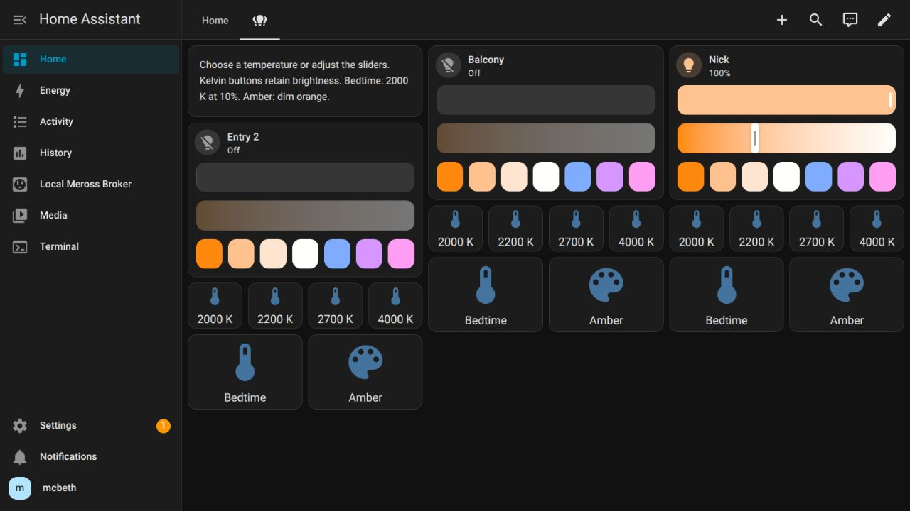

# Fixing Meross bulb temperature control

This patch restores Kelvin temperature control and correct colour-mode feedback in the Meross Cloud IoT integration. Users can set a white temperature through Home Assistant and see the reported temperature, rather than an incorrect RGB state or a failed action.

**Hardware testing was only and strictly on MSL120D bulbs. The full command sequence was tested only on MSL120D )its all I have!).**

**Compatibility with other models has not been established.**

## The fix

Home Assistant supplies colour temperature in Kelvin. The integration was treating that value as mireds and using properties removed from Home Assistant. It also selected the reported colour mode from the bulb's capabilities instead of its active setting.

The changes in `LightEntityWrapper`:

- Convert Kelvin to the device's 1–100 temperature scale and convert feedback back to Kelvin.
- Expose `color_temp_kelvin` and explicit Kelvin limits.
- Track RGB and temperature modes from device updates, preserving the mode when brightness changes.
- Send colour and brightness in one command, before turning an off bulb on.

The existing 2000–6535 K mapping is retained. It is not a measured specification of the bulb's emitted light. Diffuser temperature handling is outside this repair.

## Incorporating the patch

The branch is based on **v1.3.12**. The bulb file matches the version used for the live tests.

Maintainers can fetch the branch and review the code and tests without taking the fork's README changes :-)

## Files Changed

| File | Change |
| --- | --- |
| `custom_components/meross_cloud/light.py` | **Modified:** bulb-control repair; the only file changed on live HA. |
| `tests/test_msl120d_light.py` | **Added:** automated tests. |
| `docs/MSL120D-REPAIR.md` | **Added:** explanation and upstream adoption instructions. |
| `docs/MSL120D-test-results.json` | **Added:** sanitised live-test results. |
| `README.md` | **Modified:** introduction and link to the guide. |

## Test evidence

Test environment: Home Assistant Core **2026.11.1**, HA OS **18.4**, Meross Cloud IoT **1.3.12**, and `meross_iot` **0.4.10.4**.

Five temperature commands were checked after explicit device-update requests:

| Requested | Reported |
| --- | --- |
| 2000 K | 2000 K |
| 2200 K | 2201 K |
| 2700 K | 2700 K |
| 4000 K | 3982 K |
| 6535 K | 6535 K |

RGB `[255, 60, 0]` also read back correctly, and changing brightness retained RGB mode. A dashboard preset successfully requested 2000 K at 10% brightness. Later brightness feedback was approximately 9%, so percentage precision should not be assumed.

These are software/device read-backs, not measurements of emitted light. Three automated tests use simulated devices to check conversion, boundaries, combined commands, and mode tracking; they do not run the full Home Assistant runtime. [Detailed results](MSL120D-test-results.json) are included.

## Example Dashboard

The [example dashboard YAML](examples/meross-dashboard.yaml) provides brightness and temperature sliders, colour favourites, and preset buttons. It uses built-in Home Assistant cards; no additional dashboard components are needed.

- **2000 / 2200 / 2700 / 4000 K:** turn the selected bulb on at that temperature, retaining its brightness.
- **Bedtime:** 2000 K at 10% brightness.
- **Amber:** RGB `[255, 60, 0]` at 10% brightness.

To use it:

1. Download the [YAML file](examples/meross-dashboard.yaml). Replace **every occurrence** of `light.meross_entry`, `light.meross_balcony`, and `light.meross_third` with your own bulb entity IDs. Change the display names to suit your rooms.
2. In Home Assistant, open **Settings → Dashboards → Add dashboard** and create a **New dashboard from scratch**.
3. Open the new dashboard, select **Edit dashboard**, then choose **Raw configuration editor** from its menu. Paste the adapted YAML and save. Use a new dashboard because this file defines the whole dashboard.

For an existing dashboard, copy only the example's `Meross` view into its `views` list. Remove or duplicate a bulb's complete `vertical-stack` block to change the number of bulbs shown.

The screenshot shows the dashboard used during the MSL120D tests. The example replaces its device identifiers with placeholders. It is optional configuration and can be adopted independently of the integration repair; it does not fix an incompatible integration by itself.

## Credit

Developed through combined human/AI debugging of the Home Assistant API, integration, Meross library, and live MSL120D behaviour. Human experience and testing direction were combined with AI-assisted code analysis, implementation and test execution.

<!-- -->
:-)
